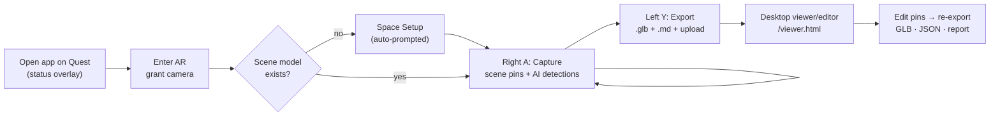
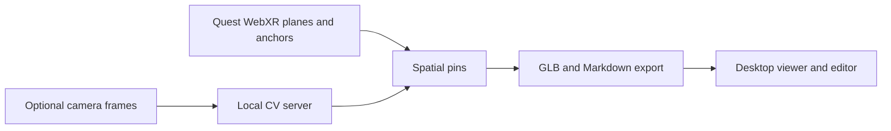
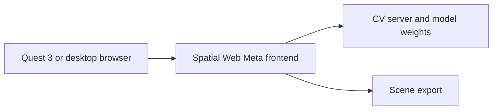

<h1 align="center">Companion Scan Quest</h1>

<p align="center"><strong>Quest 3 local world/space mapper — combines WebXR Scene Understanding with a local CV server</strong></p>

[](https://github.com/companionintelligence/CI-Spatial-Web-Meta/releases)
[](https://github.com/companionintelligence/CI-Spatial-Web-Meta)
[](LICENSE)
[](https://discord.com/invite/yQp9hwpzAa)

<p align="center"><a href="#quick-start">Get started</a> · <a href="README.md#architecture">Documentation</a> · <a href="https://docs.ci.computer/docs/reference/open-source-systems">Systems map</a></p>

<p align="center">
  <a href="#quick-start"></a>
</p>

**Companion Intelligence** · Quest 3 local world/space mapper — combines **WebXR Scene Understanding** with a **local CV server** (Grounding DINO, SAM 2, Florence-2) to produce a glTF export (plus a Markdown scan report) with rich spatial metadata, re-localizable across sessions via a **persistent WebXR anchor**.

[](docs/tutorial-scan-your-home.md)

📖 **New here? Follow the [step-by-step tutorial: scan your home into a 3D glTF](docs/tutorial-scan-your-home.md).**
🏛️ System design, schema, and diagrams: [architecture.md](architecture.md).
🧪 Testing on hardware? Use the [headset QA guide](docs/headset-testing.md).
🔌 Component wiring details: [docs/quest-capture-gltf.md](docs/quest-capture-gltf.md).

## User flow



| Step | Input | Output |
|---|---|---|
| Scan | Right **A** per view direction | Scene pins (walls/floor/furniture) + AI detections placed on real surfaces |
| Tune | Right **B** (model) · Left **X** (preview) · Trigger (display) | Model from the server registry; display modes |
| Export | Left **Y** | `companion-scan-<ts>.glb` + `.md` in Downloads, server upload |
| Edit | Desktop viewer | Pin label/confidence/position/caption edits, deletes; GLB/JSON/report re-export |
| Resume | Reload / next session | Pins restored (localStorage) + persistent-anchor re-localization |


## Features

| Feature | What it provides |
|---|---|
| **WebXR room capture** | Use Quest 3 scene planes and anchors to place spatial pins. |
| **Optional remote vision** | Send frames to a local CV server for labels and detections. |
| **Portable export** | Export a GLB and Markdown scan report for desktop review. |

## Screenshots

<table>
  <tr>
    <td valign="top"><p align="center">Desktop viewer before a scan is loaded</p></td>
    <td valign="top"><p align="center">Desktop viewer overlay</p></td>
  </tr>
</table>


## How it fits together

The headset owns tracking and pin placement; a separately hosted CV server handles optional vision, and export produces assets the desktop viewer can inspect.



## Architecture

Full diagrams (mermaid), schema reference, and coordinate conventions live in **[architecture.md](architecture.md)**.

```
Quest 3 Browser (webxr-ar-ai/)
  ├─ Pipeline A: WebXR Scene Understanding
  │    XRPlane / XRMesh → SpatialPin (MetaScene)
  │    (stable track IDs keyed on native plane/mesh identity)
  │
  ├─ Pipeline B: CV Server (network)
  │    1. snapshot viewer pose          ← frozen at frame-grab time
  │    2. CameraSource → async JPEG     ← OffscreenCanvas, off main thread
  │    3. Florence-2 / GroundingDINO / SAM2 (HTTP)
  │    4. pinhole ray per detection     ← passthrough-camera intrinsics
  │    5. SceneRaycaster                ← local raycast vs. scene geometry
  │    6. SpatialPin (CvServer)         ← hit point, or fallback distance
  │
  ├─ ScanAnchorRoot (persistent XRAnchor — scan content re-localizes)
  │    ├─ geometryRoot: SceneGeometrySnapshot (plane/mesh copies → export)
  │    └─ labelsRoot:   SpatialLabel3DRenderer (3D persistent labels)
  ├─ SpatialPinManager (unified pin store, O(1) track-id index)
  ├─ ControllerInputSystem (Quest controller buttons)
  ├─ CameraViewfinder (2D preview + BBox overlay, 30 Hz texture upload)
  ├─ WristHUD (left-wrist status panel)
  └─ GltfExporter + GltfSyncClient → POST /v1/gltf
       (exports geometryRoot only — anchor-relative, no UI meshes)

Local CV Server (cv-server/ — Docker)
  POST /v1/detect   — GroundingDINO
  POST /v1/segment  — SAM 2
  POST /v1/florence — Florence-2
  POST /v1/gltf     — Upload
  GET  /v1/health
```

### Key behaviours

- **Capture-time pose snapshot** — detection rays are cast from the head pose at the moment the camera frame was grabbed, not where the head is seconds later when the CV server responds.
- **Local scene raycast** — detections are projected onto the room geometry already captured by Scene Understanding (no per-detection XR hit-test sources, no async timeout). If nothing is hit, the pin is placed at a fallback distance along the ray — detections are never dropped.
- **Persistent anchor** — all scan content lives under a root group bound to a persistent `XRAnchor` (UUID in localStorage). Exports carry both session-world and anchor-local coordinates plus the anchor UUID.
- **Space Setup prompt** — if the session starts with no scene data, the app calls `session.initiateRoomCapture()` to launch the native Quest room-scan flow.
- **Quest tuning** — fixed foveation 1.0 and a 90 Hz target frame rate are applied on session start; canvas textures skip mipmaps; the viewfinder uploads video frames at camera rate (30 Hz) instead of render rate.

## Quick Start

### 1. Run the CV server

```bash
cd cv-server
# Download weights to cv-server/weights/ (see cv-server/README.md)
docker compose up --build
```

### 2. Run the web frontend

```bash
cd webxr-ar-ai
npm install
npm run dev
# Starts on https://0.0.0.0:8081
# If the CV server runs on another machine:
#   CV_SERVER_URL=http://<cv-host>:8000 npm run dev
```

### 3. Open on Quest 3

Navigate to `https://<PC-IP>:8081` in the Meta Quest browser and accept the certificate.
The app requests `immersive-ar` automatically (with `plane-detection`, `mesh-detection`, and `anchors`).

> The dev-server proxies `/v1/*` to the CV server so the headset never makes
> a mixed-content (HTTPS page → HTTP API) request.

**Optional camera calibration:** the passthrough camera's horizontal FOV defaults to 80° and can be tuned per device with a URL parameter, e.g. `https://<PC-IP>:8081/?hfov=75`. If pins land short of / past object edges consistently, adjust this value.

## Connecting to a server

By default the app talks to whatever's at the same origin — the Vite dev
proxy locally (`/v1/*` → `cv-server`), or the deployed site's own origin in
production. Point it at any other `cv-server`/CI-Server instance one of
three ways (in-headset overlay, desktop viewer, or both — the setting is
shared via `localStorage`):

- **URL field** — the "Server" section on the desktop overlay / viewer
  sidebar. Paste a base URL and hit Save; takes effect immediately, no
  reload.
- **One-time link** — open `https://<app>/?server=https://your-host` (add
  `&token=...` too, for a server that hands out a static API key) once.
  Meant for a Quest headset, where typing a URL on the in-headset keyboard
  is painful — the app saves it and scrubs the query string.
- **OAuth** — a "Connect via OAuth" button runs an Authorization Code + PKCE
  flow (no client secret; safe for a static site) against a configurable
  issuer. It only appears once a deployment sets `VITE_CI_OAUTH_AUTHORIZE_URL`,
  `VITE_CI_OAUTH_TOKEN_URL`, and `VITE_CI_OAUTH_CLIENT_ID` (see
  `webxr-ar-ai/.env.example`) — unconfigured, URL/token connection still
  works fine on its own.

Pointing at a server that isn't same-origin means the browser is making a
cross-origin request, so that server needs CORS enabled for your app's
origin — `cv-server` supports this out of the box via `CORS_ALLOW_ORIGINS`
(see `cv-server/docker-compose.yml`).

## Desktop tools

- **Status overlay** — the 2D page (desktop browser, or the Quest browser window before entering AR) shows live status: WebXR support, CV-server health, pin counts, the controller legend, and export buttons. It hides automatically while the immersive session is presenting.
- **Local export** — pressing Left **Y** in-headset (or **Download GLB** on the overlay) saves **two artifacts** to the device's Downloads folder — the `.glb` and a Markdown scan report (`.md`) — and then attempts the CV-server upload. A scan is never lost to an unreachable server.
- **Scan viewer & editor** — open `https://<PC-IP>:8081/viewer.html` on any desktop browser: load scans from the CV server's store or drop in a `.glb`. Renders the room geometry + pins (click to focus), and edits pins (label, confidence, position, caption, delete) with live floorplan recompute — re-export as GLB, JSON metadata, or Markdown report. The **Sample home** picker loads any of the 24 fixture homes as editable test data, no headset needed.

## Controller Button Map

| Button | Colour | Action |
|--------|--------|--------|
| Right **A** | 🔴 Red | **Capture** — run both pipelines, place 3D labels |
| Right **B** | 🔵 Blue | **Cycle Model** — Florence → GDino → SAM2 |
| Left **X** | 🟡 Yellow | **Preview Distance** — Near 1m → Far 3m → Off |
| Left **Y** | 🟢 Green | **Save & Export** — glTF upload to CV server |
| **Trigger** | 🟠 Orange | **Display Mode** — BBox2D → Label3D → Both |

## Wrist HUD (left controller)

```
Model:   Florence
Display: Both
Preview: Near (1m)
Pins:    12 cv · 8 scene
4 detections · 8 scene pins   ← status line (green/yellow/red); BUSY… during capture
```

## Project Structure

```
webxr-ar-ai/
├── index.html
├── viewer.html                       # Desktop scan viewer (drag & drop GLB)
├── vite.config.js
├── package.json
├── src/
│   ├── main.js                       # Entry: World.create + system wiring + session lifecycle
│   ├── viewer/
│   │   ├── main.js                   # Viewer page: GLB load, pin rendering, sidebar
│   │   └── scanParser.js             # Pure extras-parsing helpers
│   ├── app/
│   │   └── AppState.js               # Reactive singleton state (incl. status line)
│   ├── spatial/
│   │   ├── SpatialPin.js             # Pin data class
│   │   ├── SpatialPinManager.js      # Unified pin store (EventTarget)
│   │   └── ScanAnchorRoot.js         # Persistent-anchor root for scan content
│   ├── pipeline/
│   │   ├── PipelineA.js              # WebXR planes/meshes → pins (stable track IDs)
│   │   ├── PipelineB.js              # Camera → CV server → local raycast → pins
│   │   └── SceneRaycaster.js         # Synchronous raycast vs. scene geometry
│   ├── cv/
│   │   ├── CvServerClient.js         # REST client for /v1/*
│   │   └── CaptureEncoder.js         # Async off-main-thread JPEG encoding
│   ├── rendering/
│   │   ├── CameraViewfinder.js       # Camera preview + 2D bbox overlay
│   │   ├── SpatialLabel3DRenderer.js # 3D persistent label groups (shared geo/mats)
│   │   └── FrustumRenderer.js        # Capture-ray visualisation (batched)
│   ├── input/
│   │   └── ControllerInputSystem.js  # IWSDK ECS system for buttons
│   ├── ui/
│   │   ├── ControllerMenuBuilder.js  # Coloured disc indicators on controllers
│   │   ├── WristHUD.js               # Left-wrist canvas panel (pins + status)
│   │   └── DesktopOverlay.js         # DOM status panel for the 2D page
│   └── export/
│       ├── SceneGeometrySnapshot.js  # Plane/mesh geometry copies for export
│       ├── GltfExporter.js           # GLTFExporter + spatial metadata extras
│       ├── GltfDownload.js           # Local .glb download (headset Downloads)
│       └── GltfSyncClient.js         # Upload GLB to /v1/gltf

cv-server/
├── Dockerfile
├── docker-compose.yml
├── main.py                           # FastAPI with /v1/* endpoints
├── requirements.txt
└── README.md
```

## Export format

The GLB contains the snapshotted room geometry (anchor-relative transforms) and a `companion_scan` extras block:

```jsonc
{
  "companion_scan": {
    "version": "1.1",
    "session_id": "…",
    "exported_at": "2026-06-11T…",
    "anchor_uuid": "…",            // persistent WebXR anchor (null if unsupported)
    "pins": [{
      "position":              { "x": 0, "y": 0, "z": 0 },  // session world space
      "position_anchor_local": { "x": 0, "y": 0, "z": 0 },  // survives re-localization
      "hit_type": "mesh | plane | fallback",
      "placement_confidence": 0.95,
      // … label, bbox, semantic labels, extents, SAM2 RLE mask, caption …
    }],
    "floorplan": { "bounds": { "min": {}, "max": {} } }      // fallback pins excluded
  }
}
```

## Tech Stack

| Layer | Technology |
|-------|-----------|
| AR runtime | Meta IWSDK (`@iwsdk/core`) |
| 3D engine | Three.js (bundled in IWSDK) |
| Build | Vite 6 + vite-plugin-mkcert |
| Scene Understanding | WebXR `plane-detection` + `mesh-detection` + `anchors` |
| Raycast | Local `THREE.Raycaster` vs. scene-understanding geometry |
| Camera | IWSDK `CameraSource` component |
| AI models | Florence-2, GroundingDINO, SAM 2 (Docker) — extensible via `/v1/models` registry |
| Export | Three.js `GLTFExporter` |
| Backend | FastAPI + Uvicorn (Docker) |

## Testing

```bash
cd webxr-ar-ai
npm run test:unit    # Vitest unit tests
npm run test:e2e     # Playwright + IWER/@iwer/sem (emulated Quest 3) + mock CV server
npm run test:all
```

The e2e suite scans **24 synthetic test homes** through the real WebXR
plane/mesh-detection path (IWER synthetic environments — the same runtime
behind Meta's immersive-web-emulator) and verifies CV-detection placement
against rendered ground truth (`test-assets/cv/`). `cv-server/eval_images.py`
scores the real models on the same frames. See
[architecture.md](architecture.md#test-architecture).

## Deploy

The frontend (`webxr-ar-ai` — it's a static build, no server needed) deploys
to Cloudflare Workers. `webxr-ar-ai/wrangler.toml` wires up both
`webxr.ci.computer` and `meta.ci.computer` as Custom Domains on the same
Worker, so either can go live without a second deploy — drop whichever
route you don't want once you've decided. (`cv-server`, the GPU inference
backend, isn't part of this deploy — it stays wherever it already runs;
point the deployed frontend at it as described above.)

```bash
cd webxr-ar-ai
npx wrangler login    # once per machine
npm run deploy         # vite build && wrangler deploy
```

Or trigger it from CI — automatic deploys are gated the same way as
[`ci.yml`](docs/CI.md), so `deploy.yml` only runs on demand:

```bash
gh workflow run deploy.yml --repo companionintelligence/CI-Spatial-Web-Meta --ref main
```

That needs two repo secrets (Settings → Secrets and variables → Actions →
Secrets) — `CLOUDFLARE_API_TOKEN` (Workers Scripts: Edit) and
`CLOUDFLARE_ACCOUNT_ID`. The OAuth/default-server build variables from
`.env.example` are optional and read from **Variables** in the same repo
settings tab if you want them baked into the deployed build.

<!-- companion-hub-readme-deep-review -->

## Runtime topology

| Service | Default local address | Role |
|---|---|---|
| CV server | `http://localhost:8000` | Image/scene processing; weights are stored under `cv-server/weights/` |
| Web frontend | `https://0.0.0.0:8081` | Browser/Quest client |
| Remote CV server | Set `CV_SERVER_URL` | Allows frontend and processing to run on separate hosts |



When the CV service is on another machine, set `CV_SERVER_URL` to a reachable host and use the HTTPS frontend route needed for camera access. The CV server's own README documents weight installation and model-specific requirements.


## License

Companion Scan Quest is free for noncommercial use under the [PolyForm Noncommercial License 1.0.0](https://polyformproject.org/licenses/noncommercial/1.0.0). The full text is in [LICENSE](LICENSE). For common questions, see the [License FAQ](docs/License-FAQ.md) or email support@companionintelligence.com.

Required Notice: Copyright LifeScope INC, DBA Companion Intelligence (https://ci.computer)
