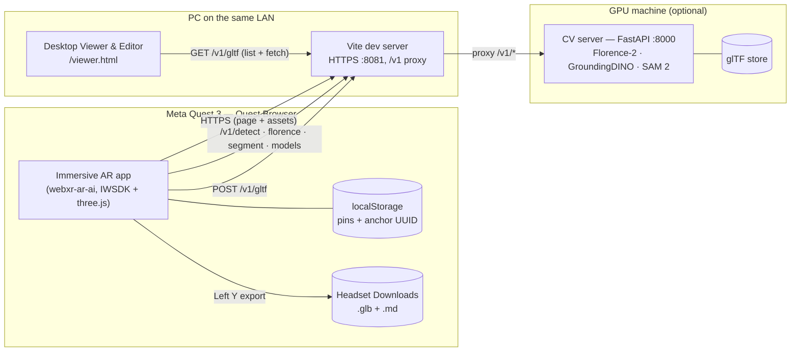
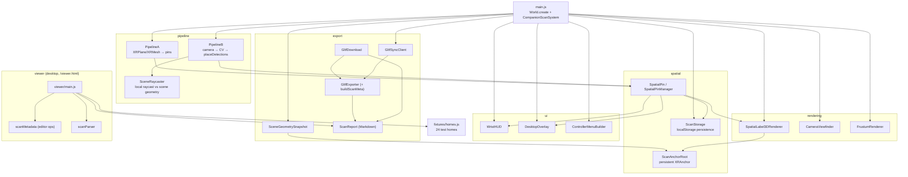
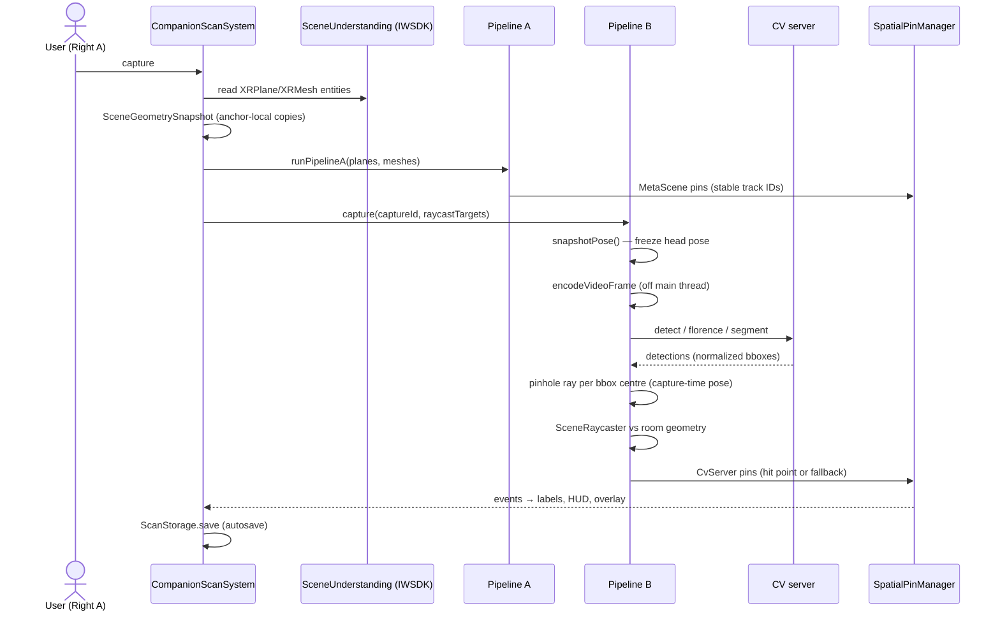
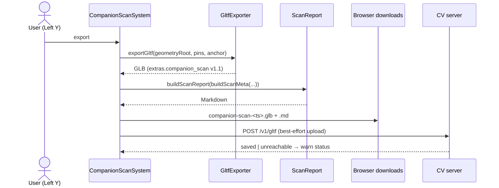
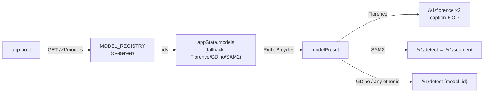
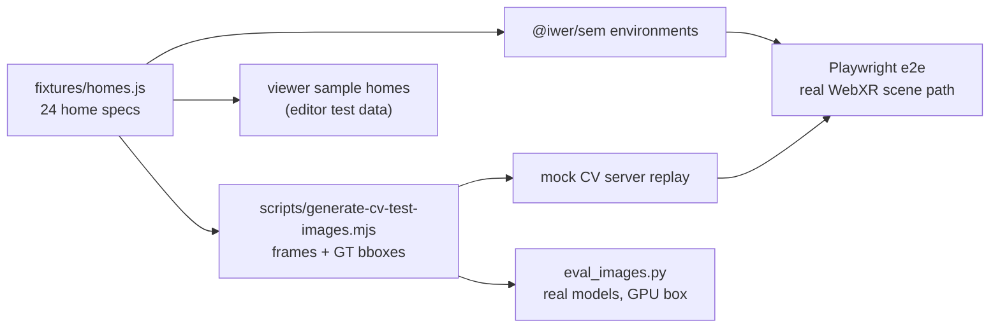

# Companion Scan Quest — Architecture

Companion Scan Quest is a browser-based Quest 3 world mapper: WebXR Scene
Understanding plus an optional CV inference server produce a portable scan
(GLB + Markdown report) that re-localizes across sessions via a persistent
WebXR anchor.

## System context

## Module map (webxr-ar-ai/src)

## Capture sequence

## Export sequence

## User flow

| # | Step | Surface | Outcome |
|---|------|---------|---------|
| 1 | Open `https://<pc>:8081` on the Quest | Desktop overlay | XR/CV status, controller legend |
| 2 | Enter AR, grant camera | Quest browser | Passthrough + viewfinder + wrist HUD |
| 3 | (first run) Space Setup prompt | Native OS flow | Scene model (planes + meshes) |
| 4 | **Right A** — capture | In-headset | Scene pins (blue) + CV detections (green) placed on real surfaces |
| 5 | **Right B / Left X / Trigger** | In-headset | Cycle model (from server registry) / preview distance / display mode |
| 6 | **Left Y** — export | In-headset | `.glb` + `.md` to Downloads, upload to CV server |
| 7 | Inspect / edit | `/viewer.html` | Load from server store or file; edit pins; re-export GLB/JSON/report |
| 8 | Reload / next session | Automatic | Pins restored from localStorage; persistent anchor re-localizes |

## Scan schema (`extras.companion_scan`, v1.1)

| Field | Type | Notes |
|---|---|---|
| `version` | string | `"1.1"` |
| `session_id` | string | capture session UUID |
| `exported_at` | ISO string | export time |
| `anchor_uuid` | string\|null | persistent WebXR anchor (re-localization key) |
| `pins[]` | array | see below |
| `floorplan.bounds` | min/max vec3 | excludes `fallback` pins |
| `floorplan.cv_pin_count` / `scene_pin_count` | number | per-source counts |

Per pin:

| Field | Type | Notes |
|---|---|---|
| `id`, `track_id` | string | identity; track IDs are stable per real-world surface |
| `source` | `CvServer` \| `MetaScene` | detection vs. scene-understanding |
| `label` | string | semantic or detector label |
| `position` | vec3 | session world space (`local-floor`) — session-ephemeral |
| `position_anchor_local` | vec3 | anchor-relative — survives sessions; **use this for re-localization** |
| `rotation` | quat | capture-time orientation |
| `confidence` | 0–1 | detector confidence |
| `hit_type` | `plane`\|`mesh`\|`fallback` | placement quality (`fallback` = distance guess) |
| `placement_confidence` | 0–1 | 0.95 raycast hit · 0.5 fallback · 1.0 scene |
| `bbox_cxcywh` | [cx,cy,w,h] | normalized image bbox |
| `semantic_labels` | string[]\|null | WebXR semantic labels |
| `plane_extents` / `volume_extents` | center+size | local-frame extents |
| `mask_rle` | object\|null | SAM 2 segmentation |
| `florence_caption` | string\|null | scene description |

### Coordinate conventions

| Frame | Origin | Used by |
|---|---|---|
| Session world | `local-floor` (floor under headset at session start) | `position`, live rendering |
| Anchor-local | persistent `XRAnchor` (UUID in localStorage) | `position_anchor_local`, exported geometry node transforms, storage |
| Plane-local | plane centre, +Y normal, polygon in XZ | `plane_extents` |
| Mesh-local | mesh space pose | `volume_extents`, vertex buffers |

Units are metres; Y is up; right-handed (WebXR convention).

## CV model system

Adding a detector = one registry entry + a lazy loader + a `req.model`
branch in `/v1/detect`. Clients need no changes.

## Test architecture

| Layer | Harness | What it proves |
|---|---|---|
| Unit (242+) | Vitest, Node | fixtures, pipelines, storage, exporters, editor ops, report |
| E2E (78) | Playwright + IWER (+ @iwer/sem) + mock CV server | real app against an emulated Quest 3 runtime |
| **24 test homes** | `fixtures/homes.js` → SEM environments | full WebXR plane/mesh-detection path: every home's plane/mesh counts and semantic labels |
| Placement ground truth | `test-assets/cv/*.png/.json` | pinhole + raycast placement vs. rendered ground truth (occlusion-aware) |
| Real-model eval | `cv-server/eval_images.py` | recall/IoU of the actual models on the synthetic frames (GPU box) |

