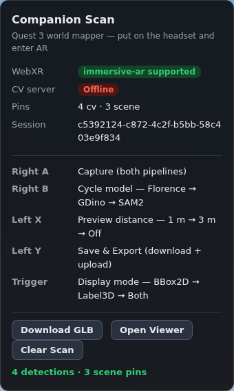
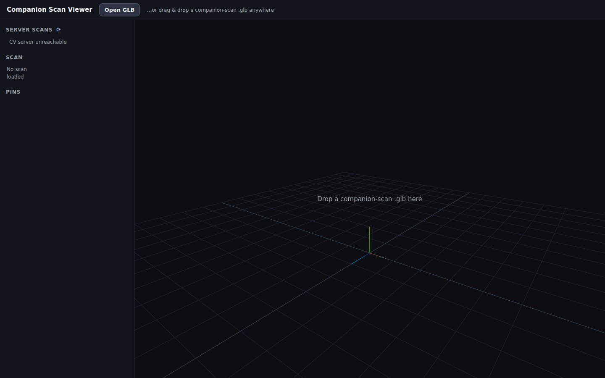
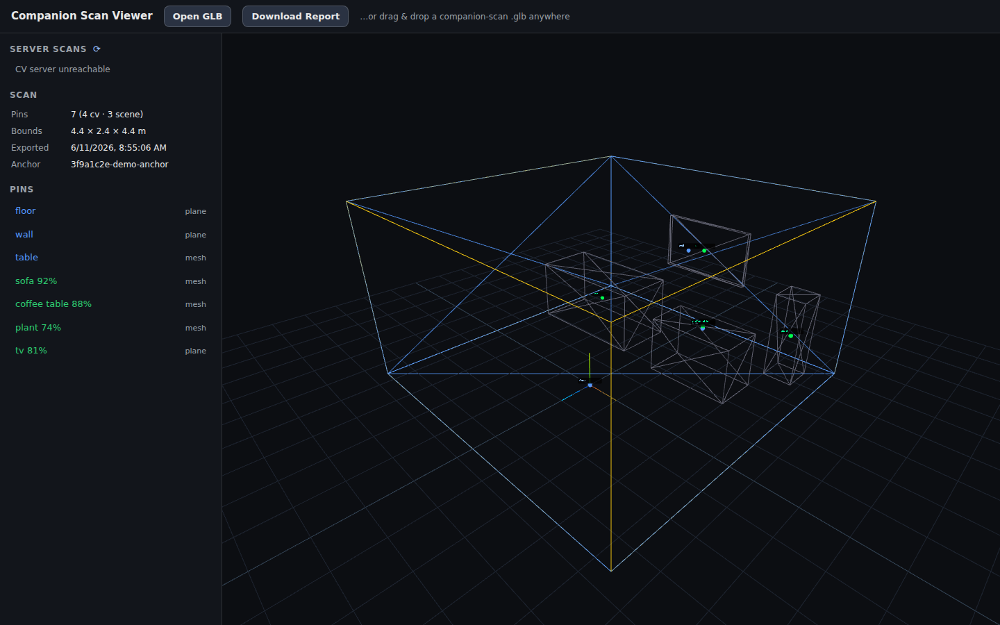

# Tutorial: Scan Your Home into a 3D glTF (and a Markdown Report)

This tutorial walks you end-to-end through turning a room of your home into
two portable artifacts using a Meta Quest 3 and a web browser — no app-store
install, no Unity build:

- **`companion-scan-<timestamp>.glb`** — a 3D glTF file containing the room's
  scanned geometry (walls, floor, furniture meshes) plus machine-readable
  spatial metadata: every detected object with its label, confidence,
  position, and semantics.
- **`companion-scan-<timestamp>.md`** — a human-readable Markdown report of
  the same scan: room dimensions, a table of surfaces, a table of detected
  objects, and AI-generated scene descriptions.

Both are produced by a single button press on the controller.

---

## 1. What you need

| Requirement | Notes |
|---|---|
| Meta Quest 3 / 3S | Horizon OS v74+ (passthrough camera access in the browser) |
| A PC on the same Wi-Fi | Hosts the web app; any OS with Node.js 20+ |
| *(Optional)* a GPU machine | Runs the AI models (Florence-2, GroundingDINO, SAM 2) — without it you still get the full room geometry scan, just no AI object detection |
| ~15 minutes | First-time setup included |

## 2. Start the app on your PC

```bash
git clone https://github.com/companionintelligence/CI-WebXR-Scan-Meta.git
cd CI-WebXR-Scan-Meta/webxr-ar-ai
npm install
npm run dev
# → https://0.0.0.0:8081
```

**Optional — AI object detection.** In a second terminal, start the CV
server (needs a CUDA GPU and the model weights, see `cv-server/README.md`):

```bash
cd CI-WebXR-Scan-Meta/cv-server
docker compose up --build
```

If the CV server runs on a *different* machine than the web app:

```bash
CV_SERVER_URL=http://<gpu-machine-ip>:8000 npm run dev
```

Find your PC's LAN IP (`ipconfig` on Windows, `ip addr` on Linux,
`ifconfig` on macOS) — you'll need it on the headset.

## 3. Open it on the Quest

1. Put on the headset and open the **Meta Quest Browser**.
2. Navigate to `https://<your-PC-IP>:8081`.
3. Accept the self-signed certificate warning (**Advanced → Proceed**).

You'll see the status panel. Before entering AR, check the two badges:



- **WebXR: immersive-ar supported** — you're good to go.
- **CV server: Online / Offline** — Offline just means no AI detection;
  the geometry scan works regardless.

The panel also shows the controller cheat-sheet — worth 10 seconds before
you enter AR.

## 4. Enter AR and set up your space

Click the browser's **Enter AR** prompt, then:

1. **Grant camera permission** when asked — this feeds the AI pipeline and
   the small viewfinder you'll see floating in front of you.
2. If you've never run **Space Setup** on this Quest, the app detects that
   and launches the native room-scan flow automatically after ~2 seconds.
   Follow the on-device instructions: walk the room, let it trace your
   walls and furniture, confirm. Then re-enter AR from the browser.

You're now standing in your room with:

- a **viewfinder** (small camera preview) floating ahead of you,
- a **wrist HUD** on your left controller showing the current mode,
- colored **button indicators** on both controllers.

```
 Wrist HUD                      Controller buttons
 ┌────────────────────────┐     Right A (red)    — Capture
 │ Model:   Florence      │     Right B (blue)   — Cycle AI model
 │ Display: Both          │     Left  X (yellow) — Preview distance
 │ Preview: Near (1m)     │     Left  Y (green)  — Save & Export
 │ Pins:    0 cv · 0 scene│     Trigger (orange) — Display mode
 │                        │
 └────────────────────────┘
```

## 5. Scan the room

The workflow is: **look → capture → repeat**.

1. **Stand near the middle of the room** and look toward a furnished corner.
2. **Press Right A (Capture).** The HUD shows `BUSY…`, then a result line
   like `4 detections · 6 scene pins`. Two things happened:
   - *Pipeline A* snapshotted the room geometry the Quest already knows —
     walls, floor, ceiling, furniture volumes — as blue-labeled pins.
   - *Pipeline B* (if the CV server is up) photographed the view, ran AI
     object detection, and projected each detection onto the real surfaces —
     green labels pinned to your actual sofa, table, plant.
3. **Turn ~60° and capture again.** Repeat until you've covered the room
   (4–6 captures for a typical room). Re-capturing the same objects is fine —
   pins update in place rather than duplicating.
4. **Try the other AI models** with Right B:
   - **Florence** — captions the scene + detects general objects (default)
   - **GDino** — fast open-vocabulary detection (chairs, tables, screens…)
   - **SAM2** — adds segmentation masks per object (slower, richest data)

**Tips while scanning**

- Hold your head still for a beat when pressing A — sharper photos mean
  better detections (placement is motion-compensated, so walking between
  captures is fine).
- Orange rays flash from your head to each detection for 1.5 s — they show
  you exactly what got pinned where.
- Pull the **Trigger** to cycle what's displayed (2D boxes on the
  viewfinder, 3D labels in the room, or both).
- Your scan **auto-saves locally** after every capture. You can take the
  headset off, come back later, reload the page, and continue — the pins
  are restored (the persistent anchor puts them back in the right spots in
  your room).

## 6. Export: one button, two files

Press **Left Y (Save & Export)**. The app:

1. **Downloads `companion-scan-<timestamp>.glb`** to the headset's
   Downloads folder — always works, even with no CV server.
2. **Downloads `companion-scan-<timestamp>.md`** — the Markdown report,
   same place.
3. **Uploads the GLB to the CV server** (if reachable) so you can open it
   on your desktop without touching the headset's files.

The HUD confirms: green `Exported …` (upload worked) or yellow
`Saved … · upload failed` (files are on the headset, server unreachable).

## 7. Inspect the scan on your desktop

Open `https://<your-PC-IP>:8081/viewer.html` in any desktop browser:



Load your scan one of two ways:

- **Server scans** (left panel) — if the export uploaded, your scan is
  listed; click it.
- **Open GLB / drag & drop** — for files copied off the headset
  (connect via USB and pull from `Download/`, or use the Files app to
  share them).



What you're looking at:

- **Blue wireframe** — planes (walls, floor) from the Quest's scene model
- **Gray wireframe** — furniture and room meshes
- **Green spheres** — AI-detected objects, **blue spheres** — scene surfaces
- **Yellow box** — the room's computed floorplan bounds
- **Sidebar** — every pin with label, confidence, and placement type;
  click one to fly the camera to it

The **Download Report** button regenerates the Markdown report from any
loaded GLB — handy if you only kept the `.glb`.

## 8. What's inside the two files

### The glTF (`.glb`)

A standard glTF 2.0 binary that any glTF tool (Blender, three.js,
Babylon.js, Windows 3D Viewer) can open — the geometry is real triangle
meshes of your room. Companion-specific data lives in the scene's
`extras.companion_scan` block:

```jsonc
{
  "companion_scan": {
    "version": "1.1",
    "anchor_uuid": "…",                 // persistent WebXR anchor (re-localization)
    "pins": [{
      "label": "sofa",
      "confidence": 0.92,
      "position_anchor_local": { "x": -1.2, "y": 0.45, "z": -1.4 },
      "hit_type": "mesh",               // landed on real geometry
      "semantic_labels": null,
      "florence_caption": "a cozy living room with a grey sofa…",
      // … bbox, masks, extents, timestamps …
    }],
    "floorplan": { "bounds": { "min": {}, "max": {} } }
  }
}
```

All positions are **anchor-local**: relative to a persistent spatial anchor
on your Quest, so a scan exported today can be re-aligned to your room in a
future session on the same device.

### The Markdown report (`.md`)

Generated from the same data — here is a real example:

```markdown
# Companion Scan Report

| | |
|---|---|
| Exported | 2026-06-11T16:32:08Z |
| Session | `demo-session` |
| Anchor UUID | `3f9a1c2e-demo-anchor` |
| Pins | 7 (4 detections · 3 scene surfaces) |
| Room bounds | 4.4 × 2.4 × 4.4 m |

## Room structure (WebXR Scene Understanding)

| Surface | Type | Position (anchor-local) | Size |
|---|---|---|---|
| floor | plane | (0.00, 0.00, 0.00) | 4.40 × 4.40 m |
| wall | plane | (0.00, 1.40, -2.00) | 4.40 × 2.40 m |
| table | mesh | (0.90, 0.75, -1.20) | 1.20 × 0.78 × 0.60 m |

## Detected objects (CV pipeline)

| Object | Confidence | Placement | Position (anchor-local) |
|---|---|---|---|
| sofa | 92% | on room mesh | (-1.20, 0.45, -1.40) |
| coffee table | 88% | on room mesh | (0.90, 0.78, -1.20) |
| plant | 74% | on room mesh | (1.70, 0.60, -2.10) |
| tv | 81% | estimated (50%) | (0.00, 1.30, -2.40) |

### Scene descriptions (Florence-2)

> a cozy living room with a grey sofa and a wooden coffee table
```

## 9. Scanning multiple rooms / starting over

- **New room**: press **Clear Scan** on the status panel (or run Space Setup
  for the new room), then scan and export — each export is a self-contained
  pair of files.
- **Improve accuracy**: if green pins land consistently offset from their
  objects, calibrate the camera FOV once for your device — reload with
  `https://<PC-IP>:8081/?hfov=75` and nudge the value (70–90) until pins
  stick to object centers. See
  [docs/headset-testing.md](headset-testing.md) for the full procedure.

## Troubleshooting

The most common first-run issues:

| Problem | Fix |
|---|---|
| Certificate page won't proceed | Type the URL with `https://` explicitly |
| `CV server: Offline` | Fine for geometry-only scans; otherwise check `CV_SERVER_URL` and that `curl http://<host>:8000/v1/health` works from the PC |
| No viewfinder in AR | Camera permission was denied — reset it in browser site settings |
| Capture finds no surfaces | Run Space Setup (Settings → Physical Space) and reload |
| Export "did nothing" | Check the headset's Downloads folder — the toast is easy to miss |

The complete on-device QA checklist and troubleshooting table lives in
[docs/headset-testing.md](headset-testing.md).
